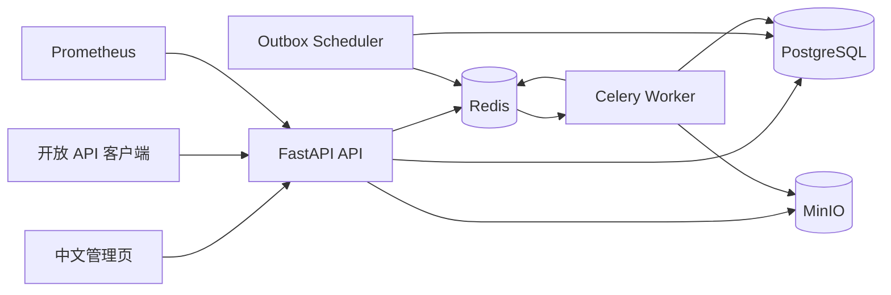
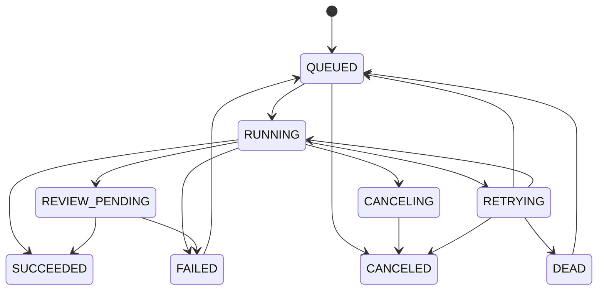

# 工业图档异步处理与审核平台项目报告

| 项目项 | 内容 |
| --- | --- |
| 项目名称 | 工业图档异步处理与审核平台 |
| 项目类型 | Python 后端平台 / 异步任务系统 / 人工审核系统 |
| 技术基线 | Python 3.12、FastAPI、Celery、PostgreSQL、Redis、MinIO |
| 报告日期 | 2026-10-05 |
| 项目状态 | MVP 已实现并通过本地 Docker 全链路验收 |
| 主要入口 | `http://localhost:8000`；API 文档：`http://localhost:8000/docs` |

## 一、项目背景与定位

工业图档通常包含 PDF、SVG、Gerber 等不同格式，处理过程既包含文件解析、规则校验和结果生成，也包含异常任务重试、人工复核、责任审计等业务流程。传统“上传文件 + 数据库查询”的实现无法覆盖任务可靠性、并发审核和可追溯性要求。

本项目将文件处理抽象为异步任务，以 PostgreSQL 作为业务状态真相源，以 Redis/Celery 承担异步投递，以 MinIO 保存原始文件和解析结果，并提供规则自动分流和人工审核闭环。

项目目标不是只展示 CRUD，而是验证以下后端工程能力：

- 异步任务从提交到完成的完整生命周期管理
- 幂等、去重和重复消息下的数据一致性
- 临时故障重试、执行租约恢复和死信处理
- 审核并发领取、职责分离和不可覆盖的审核结论
- trace ID 贯穿 API、Outbox、Worker 和审核链路
- Docker Compose 一键启动和可重复测试

## 二、需求与成功标准

### 2.1 功能需求

1. 上传 PDF、SVG、Gerber 文件并创建解析任务。
2. 查询任务列表、详情、进度、结果和事件历史。
3. 支持任务取消、自动重试和管理员手工重试。
4. 使用 `Idempotency-Key` 和 SHA256 防止重复提交与重复处理。
5. 使用规则引擎将任务自动分流为成功、失败或待人工复核。
6. 支持审核员并发领取、释放、通过和驳回审核单。
7. 审核员不能审核自己提交的任务。
8. 保存原始文件、解析结果、审核记录和 append-only 审计日志。
9. 提供 SSE 任务进度、统一异常、结构化日志、健康检查和 Prometheus 指标。
10. 使用 Docker Compose 启动全部服务。

### 2.2 非功能目标

- **一致性**：数据库保存任务、审核和审计状态的唯一真相。
- **可靠性**：至少一次投递，通过事务 Outbox 和执行幂等吸收重复消息。
- **可恢复性**：Worker 崩溃后，过期执行租约可由调度器恢复。
- **可观测性**：HTTP 请求、任务、Retry、DLQ、队列和审核积压可观测。
- **可测试性**：核心领域逻辑与框架解耦，具有单元测试和端到端测试。
- **安全性**：JWT、RBAC、Argon2、文件类型限制和安全 XML 解析。

## 三、总体架构



### 3.1 运行时组件

| 组件 | 职责 |
| --- | --- |
| API | 认证、上传、查询、取消、重试、审核、规则、DLQ、SSE |
| Outbox Scheduler | 发布事务事件、恢复过期执行租约 |
| Celery Worker | 下载文件、解析、规则判断、结果上传、状态更新 |
| PostgreSQL | 用户、文件、任务、执行、规则、审核、审计和 Outbox |
| Redis | Celery Broker、SSE Pub/Sub、队列深度统计 |
| MinIO | `raw` 和 `results` 两类对象存储 |
| Prometheus | 抓取业务与 HTTP 指标 |
| Jinja2 管理页 | 可视化完成上传、进度、审核和管理操作 |

### 3.2 设计取向

- 采用模块化单体，而不是过早拆分为微服务。
- 采用 Redis/Celery，而不是引入不必要的事件流平台。
- 采用事务 Outbox，而不是数据库提交后直接发送消息。
- 采用 PostgreSQL 并发锁与租约，而不是仅依赖 Redis 分布式锁。
- 采用规则审核，而不是把自动审核等同于 AI。
- 采用 SSE，而不是为单向进度推送引入 WebSocket。

## 四、核心实现

### 4.1 文件上传、幂等和去重

上传流程：

1. 流式读取文件并计算 SHA256，避免一次性占用大量内存。
2. 校验单文件大小，默认限制为 50 MiB。
3. 校验扩展名和基础文件签名。
4. 检查 `(owner_id, idempotency_key)` 和 `(owner_id, sha256)` 唯一性。
5. 将原始文件写入 MinIO `raw` bucket。
6. 在同一个数据库事务中创建文件、任务、任务事件、Outbox 事件和审计记录。

幂等语义：

- 首次创建返回 HTTP 201。
- 相同用户、相同幂等键返回原任务。
- 相同用户、相同 SHA256 返回已有任务，并标记 `deduplicated=true`。
- 相同幂等键用于不同文件返回 HTTP 409。
- 数据库唯一约束负责处理并发提交竞争。

### 4.2 事务 Outbox 与 Celery

任务创建事务同时写入 Outbox，避免数据库成功但消息未发送的问题。

调度器行为：

- 使用 `FOR UPDATE SKIP LOCKED` 批量领取待发布事件。
- 按高、普通、低优先级投递到独立 Celery 队列。
- 投递成功后记录 `published_at`。
- 投递失败后按指数退避重新尝试。
- 调度器在“发送成功但标记失败”的场景崩溃时会产生重复消息，因此必须依赖 Worker 幂等。

### 4.3 Worker 执行与可靠性

Worker 使用以下机制：

- `acks_late` 和 `prefetch_multiplier=1`
- 一个 Outbox 事件对应唯一执行记录
- 数据库原子领取，避免多个 Worker 同时执行
- 执行租约和进度检查点
- 旧 Worker 被恢复任务接管后的所有权校验
- Worker 崩溃后的过期租约恢复

解析结果先写入 MinIO，再通过数据库事务更新任务状态、规则结果和审核单。

### 4.4 任务状态机



状态更新必须通过状态机校验，非法转换会返回 409，不会直接覆盖任务状态。

### 4.5 重试与死信

- 默认执行 1 次初始任务和最多 3 次自动重试。
- 退避时间按 `2^(attempt-1)` 计算，并设置上限。
- 临时错误进入 `RETRYING`。
- 永久解析错误进入 `FAILED`，不自动重试。
- 重试耗尽进入 `DEAD`，创建 DeadLetter，并写入 Redis `tasks.dlq`。
- 管理员可以从死信队列重新入队。
- 审核驳回形成终态失败，必须重新提交新文件，不能重跑旧任务。

### 4.6 图档解析与规则引擎

| 格式 | 解析内容 | 基础校验 |
| --- | --- | --- |
| PDF | 页数、元数据、加密状态、有限文本摘要 | PDF 文件签名、加密检查、页数阈值 |
| SVG | XML 根节点、尺寸、ViewBox、元素统计 | DTD/实体安全、脚本、外部引用、尺寸缺失 |
| Gerber | FS、MO、AD、D01/D02/D03、M02、孔径和操作统计 | 格式定义、单位定义、结束标记、未知命令 |

规则存储在 PostgreSQL 中并带版本号。管理员可以启停规则和修改受支持的阈值，修改会创建新版本并写入审计日志。任务引用提交时生效的规则版本。

分流逻辑：

- 任一 critical finding：任务 `FAILED`
- 仅存在 warning：任务 `REVIEW_PENDING`
- 无告警：任务 `SUCCEEDED`

### 4.7 人工审核闭环

- 解析产生 warning 时自动创建审核单。
- 审核员可以领取下一单或领取指定审核单。
- 领取使用 PostgreSQL 条件更新和 `SKIP LOCKED`，防止并发重复领取。
- 审核租约默认 30 分钟。
- 审核员可以释放自己领取的审核单。
- 审核员不能审核自己提交的任务。
- 驳回必须填写审核意见。
- 审核结论不可覆盖，审核通过后任务成功，驳回后任务永久失败并保留意见。

### 4.8 审计日志

审计记录采用 append-only 哈希链：

- 记录操作者、动作、资源、前后值、时间、trace ID。
- 每条记录包含前序哈希和当前哈希。
- 链头使用数据库行锁串行更新。
- 管理员可以执行完整性校验。
- 审计事件不提供修改和删除接口。

### 4.9 可观测性与链路追踪

- 从 `X-Trace-ID` 读取或自动生成 trace ID。
- trace ID 写入结构化日志、Outbox、Worker、任务事件和审计事件。
- `/health/live`：进程存活检查。
- `/health/ready`：PostgreSQL、Redis、MinIO 就绪检查。
- `/metrics`：HTTP 延迟、任务状态、平均进度、Outbox 积压、DLQ、审核积压和队列深度。
- 日志为 JSON 格式，便于日志平台采集。

## 五、数据模型

| 表 | 用途 |
| --- | --- |
| `users` | 用户、角色和密码哈希 |
| `files` | 文件元数据、SHA256、MinIO 对象位置 |
| `tasks` | 任务状态、进度、优先级、失败信息和结果摘要 |
| `task_events` | 任务状态与进度事件 |
| `task_executions` | 每次 Worker 执行的幂等记录和租约 |
| `outbox_events` | 事务消息和发布状态 |
| `parse_artifacts` | MinIO 中的解析结果文件 |
| `rule_definitions` | 版本化审核规则 |
| `rule_findings` | 任务命中的规则结果 |
| `review_cases` | 审核状态、领取人、租约和审核结论 |
| `audit_events` | append-only 哈希链审计记录 |
| `audit_chain_heads` | 审计链当前哈希 |
| `dead_letters` | 重试耗尽任务 |
| `system_state` | 全局规则版本等运行时状态 |

关键约束：

- `files(owner_id, sha256)` 唯一
- `tasks(owner_id, idempotency_key)` 唯一
- `review_cases(task_id)` 唯一
- `task_executions(outbox_event_id)` 唯一

## 六、API 概览

### 6.1 认证

| 方法 | 路径 | 说明 |
| --- | --- | --- |
| POST | `/api/v1/auth/login` | 登录并设置 HttpOnly Cookie |
| POST | `/api/v1/auth/logout` | 退出并清理 Cookie |
| GET | `/api/v1/auth/me` | 当前用户 |

### 6.2 任务

| 方法 | 路径 | 说明 |
| --- | --- | --- |
| POST | `/api/v1/tasks` | 上传并创建任务 |
| GET | `/api/v1/tasks` | 任务列表和筛选 |
| GET | `/api/v1/tasks/{id}` | 任务详情、事件、规则和审核信息 |
| POST | `/api/v1/tasks/{id}/cancel` | 取消任务 |
| POST | `/api/v1/tasks/{id}/retry` | 重试技术失败或死信任务 |
| GET | `/api/v1/tasks/{id}/result` | 查询结果摘要和规则发现 |
| GET | `/api/v1/tasks/{id}/download` | 下载原文件或结果文件 |
| GET | `/api/v1/tasks/{id}/events` | SSE 实时事件 |

### 6.3 审核

| 方法 | 路径 | 说明 |
| --- | --- | --- |
| GET | `/api/v1/reviews` | 审核列表 |
| POST | `/api/v1/reviews/claim-next` | 领取下一审核单 |
| POST | `/api/v1/reviews/{id}/claim` | 领取指定审核单 |
| POST | `/api/v1/reviews/{id}/release` | 释放审核单 |
| POST | `/api/v1/reviews/{id}/decision` | 通过或驳回 |

### 6.4 管理接口

| 方法 | 路径 | 说明 |
| --- | --- | --- |
| GET/POST | `/api/v1/admin/rules` | 规则列表和新建 |
| PATCH | `/api/v1/admin/rules/{id}` | 创建规则新版本 |
| GET | `/api/v1/admin/dead-letters` | 死信列表 |
| POST | `/api/v1/admin/dead-letters/{id}/requeue` | 死信重新入队 |
| GET | `/api/v1/admin/audit` | 审计列表 |
| POST | `/api/v1/admin/audit/verify` | 审计链完整性校验 |

OpenAPI 当前包含 34 个路径和 32 个 Schema。

## 七、管理页面

管理页由 FastAPI 与 Jinja2 直接提供，不依赖 Node 构建链，包含：

- 登录页
- 任务列表与状态统计
- 文件上传和优先级选择
- 任务详情、进度、事件、规则结果和下载
- 审核队列、领取、释放和决策
- 规则版本启停
- 死信查看与重新入队
- 审计日志和完整性校验

## 八、部署与运行

### 8.1 一键启动

```powershell
cd 'H:\Codex\简历项目\简历项目1'
docker compose up --build -d
```

### 8.2 服务地址

| 服务 | 地址 |
| --- | --- |
| 管理页 | http://localhost:8000 |
| Swagger | http://localhost:8000/docs |
| 健康检查 | http://localhost:8000/health/ready |
| Prometheus | http://localhost:9090 |
| MinIO Console | http://localhost:9001 |

### 8.3 演示账号

| 角色 | 邮箱 | 密码 |
| --- | --- | --- |
| 管理员 | `admin@example.com` | `Admin123!` |
| 审核员 | `reviewer@example.com` | `Reviewer123!` |
| 提交者 | `submitter@example.com` | `Submitter123!` |

## 九、测试与验收结果

### 9.1 静态质量门禁

| 检查 | 结果 |
| --- | --- |
| Python 编译检查 | 通过 |
| Ruff | 全部通过 |
| MyPy | 39 个模块无错误 |
| pytest 默认套件 | 19 passed, 1 skipped |
| OpenAPI 生成 | 34 paths、32 schemas |
| Docker Compose 配置校验 | 通过 |

被默认跳过的测试是必须连接运行环境的 E2E 测试；单独配置 `E2E_BASE_URL` 后已实际执行并通过。

### 9.2 Docker 服务状态

实际运行状态：

| 服务 | 状态 |
| --- | --- |
| API | healthy |
| Worker | running |
| Scheduler | running |
| PostgreSQL | healthy |
| Redis | healthy |
| MinIO | healthy |
| Prometheus | running |

### 9.3 端到端验证

E2E 测试实际覆盖：

1. 管理员、审核员和提交者登录。
2. 上传合法 Gerber 文件。
3. 等待 Outbox 发布、Celery 消费、解析和规则判断。
4. 验证任务自动进入 `SUCCEEDED`。
5. 使用不同幂等键重复上传相同文件。
6. 验证返回原任务且 `deduplicated=true`。
7. 上传缺少尺寸信息的 SVG。
8. 验证任务进入 `REVIEW_PENDING`。
9. 提交者尝试审核自己的任务，验证返回 403。
10. 管理员和审核员并发领取同一审核单。
11. 验证只有一个领取请求成功，另一个返回 409。
12. 审核员/管理员驳回任务并填写意见。
13. 验证任务进入 `FAILED`，失败码为 `REVIEW_REJECTED`。
14. 校验完整审计哈希链。
15. 验证实际 MinIO 对象存储参与上传和结果保存。

最终结果：端到端测试 `1 passed`。

## 十、项目亮点

- **事务 Outbox**：解决数据库与消息队列之间的双写不一致。
- **消费幂等**：至少一次投递下，避免重复消息造成重复业务结果。
- **执行租约**：Worker 崩溃后可自动恢复，而不是永久卡在 `RUNNING`。
- **状态机约束**：任务状态非法转换会被明确拒绝。
- **审核并发控制**：数据库锁保证同一审核单只有一个审核员领取成功。
- **职责分离**：从服务层禁止自审，而不是只依赖前端隐藏按钮。
- **审计不可覆盖**：哈希链可以检测历史记录被篡改。
- **双通道进度**：数据库保存真相，SSE 提供实时体验，断线后仍可从数据库恢复。
- **真实格式处理**：不是仅根据扩展名返回假结果，而是实际读取和检查文件。
- **完整工程化**：包含 Alembic、CI、Ruff、MyPy、pytest、Docker 和 Runbook。

## 十一、当前边界与限制

本项目定位为可运行的展示级 MVP，以下能力暂未实现：

- 多租户、PostgreSQL RLS 和租户配额
- OAuth2/OIDC、刷新令牌和密钥轮换
- 会签、或签、加签、转审、申诉和 SLA 升级
- 高精度 Gerber 几何分析和工业级渲染
- PDF 版面理解、OCR 和图纸语义识别
- ClamAV 或企业病毒扫描
- MinIO WORM、跨区域复制和对象加密
- Kubernetes、Helm 和灰度发布
- 大规模负载、压力与稳定性测试
- 高可用 PostgreSQL、Redis 和对象存储集群

MinIO 上游镜像分发在 2026 年发生变化，项目使用 `bitnamilegacy/minio:latest` 作为当前可运行的 MinIO 打包镜像，并保留 `MINIO_IMAGE` 环境变量以便切换到组织认可的镜像源。

## 十二、后续路线图

### 第一阶段：生产基础

- 接入 OAuth2/OIDC
- 增加租户隔离和 RLS
- 增加 Virus Scan
- 增加正式限流和 WAF
- 增加备份恢复与密钥管理
- 建立容量模型和压测基线

### 第二阶段：审核能力

- 会签、或签、加签和转审
- 审核 SLA、超时升级和自动分配
- 审核绩效和运营报表
- 更细粒度的数据和字段权限

### 第三阶段：解析能力

- Gerber 几何层、铜箔面积和最小线宽检查
- SVG/PDF 渲染和安全沙箱
- PDF/OCR 版面识别
- 规则表达式和动态插件
- 可配置的通知渠道

### 第四阶段：平台化

- 多业务类型接入
- 插件化解析器
- 独立审核服务
- 跨服务 trace 和统一事件目录
- Kubernetes/Helm 部署和灰度发布

## 十三、简历表述建议

可将项目概括为：

> 设计并实现基于 FastAPI、Celery、PostgreSQL、Redis 和 MinIO 的工业图档异步处理与审核平台。通过事务 Outbox、消费幂等、状态机、执行租约和死信队列保障任务可靠性；实现基于 SHA256 与 Idempotency-Key 的文件去重；使用数据库 `SKIP LOCKED` 实现并发审核领取和职责分离；通过 trace ID、Prometheus、SSE 和 append-only 审计链完善可观测性、实时反馈与合规追溯。

可拆分的关键成果：

- 实现任务提交至结果落库的完整异步链路，支持取消、重试、超时恢复和死信重投。
- 设计事务 Outbox 与至少一次消费幂等机制，避免数据库和消息队列双写不一致。
- 实现并发审核领取、审核租约和禁止自审，确保审核结论不可覆盖。
- 实现 PDF、SVG、Gerber 基础真实解析和版本化规则自动分流。
- 建立 Docker Compose、CI、单元测试、E2E、健康检查和 Prometheus 监控体系。

## 十四、结论

本项目已经形成完整的工业图档异步处理与审核闭环，不只是“上传文件 + 数据库 + 查询”的演示。系统以 PostgreSQL 为真相源，通过 Outbox 和 Celery 实现可靠异步执行，通过状态机、幂等和死信保证任务可控，通过数据库锁和职责分离保证审核一致性，通过 trace ID、Prometheus 和哈希链审计满足日常运维与追溯需求。

当前版本适合作为后端工程能力项目、面试展示项目和后续生产化演进基础。
