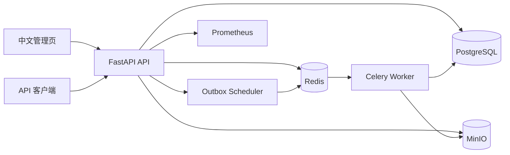

# 项目案例研究：工业图档异步处理与审核平台

## 一、项目要解决的问题

工业图档处理不是一次普通的“上传并解析”操作。一个 PDF、SVG 或 Gerber 文件进入系统后，需要依次经过文件校验、对象存储、异步解析、规则判断、结果回写，部分任务还必须进入人工审核。任何一个环节异常，都可能出现任务重复执行、状态不一致、审核抢占或审计记录缺失。

这个项目把上述流程实现为一个可运行的模块化单体平台，重点验证后端工程中的一致性、可靠性和可观测性，而不是只实现一套 CRUD 接口。

## 二、系统架构



数据库是任务状态的唯一真相源，Redis/Celery 负责异步投递，MinIO 保存原始文件和解析结果。API、Scheduler 和 Worker 采用相同领域模型，避免三套状态逻辑相互漂移。

## 三、核心难点与处理方式

| 难点 | 风险 | 本项目实现 |
|---|---|---|
| 重复提交 | 同一文件被多次创建、重复占用资源 | `Idempotency-Key` + 用户级唯一约束 + SHA256 内容去重 |
| 消息与事务不一致 | 数据库已提交，但 Celery 消息没有发出 | 事务 Outbox：业务状态和待投递事件在同一事务写入 |
| Worker 崩溃 | 任务长期停留在 `RUNNING` | 执行租约 + Scheduler 扫描 + 过期任务恢复到 `RETRYING` |
| 重复消费 | 同一任务被多个 Worker 并行执行 | `task_executions.outbox_event_id` 唯一约束 + 执行幂等 |
| 审核并发领取 | 多个审核员同时处理同一审核单 | PostgreSQL 条件更新 + `FOR UPDATE SKIP LOCKED` |
| 审核职责冲突 | 提交人给自己审核 | 审核决策事务中显式执行职责分离校验 |
| 审计不可信 | 审核记录可被静默修改 | append-only 事件 + SHA256 前序哈希链校验 |
| 进度展示 | 一次查询之后无法看到后续变化 | SSE：先回放数据库事件快照，再订阅 Redis 增量事件 |
| 故障定位 | 跨 API、消息和 Worker 无法串联 | Trace ID 贯穿请求、Outbox payload、Celery 任务和审计事件 |

### 关键设计取舍

- **模块化单体而不是微服务**：项目规模不需要承担服务发现、链路熔断和多仓库部署成本。
- **PostgreSQL 作为状态真相源**：Redis 可以丢消息或重启，但不能成为任务状态的权威来源。
- **至少一次投递而不是追求理论上的恰好一次**：把重复交给唯一约束和幂等逻辑吸收。
- **规则引擎而不是“AI 自动审核”**：当前业务边界清晰，可解释性和可测试性优先。
- **SSE 而不是 WebSocket**：进度推送天然是单向流，SSE 的协议和运维复杂度更低。

## 四、验证与质量保障

本地单元测试结果：

```text
19 passed, 1 skipped
```

跳过的是依赖实际运行栈的 E2E 用例；GitHub Actions 的 `compose-e2e` Job 会启动 PostgreSQL、Redis、MinIO、API 和 Worker，再执行端到端测试。除此之外，CI 还包含 Ruff、Mypy 和 Pytest。

关键质量属性：

- `/health/live` 检查进程存活，`/health/ready` 检查 PostgreSQL、Redis、MinIO。
- `/metrics` 暴露任务状态、进度、Outbox 积压、死信、审核积压和队列深度。
- 失败任务最多执行一次初始尝试加三次自动重试，重试耗尽后进入死信。
- 管理页覆盖上传、任务详情、审核、规则、死信和审计验证。
- SVG 使用安全 XML 解析，文件限制 50 MiB，上传对象键不直接使用原文件名。

## 五、当前边界

项目当前定位为 MVP，已经覆盖异步任务和人工审核的核心闭环，但以下能力仍属于生产化范围：

- 多租户与 PostgreSQL RLS。
- OAuth2/OIDC、刷新令牌和密钥轮换。
- 病毒扫描、DLP 和更细粒度的敏感字段保护。
- MinIO 服务端加密、WORM 和跨区域复制。
- API 全局限流、WAF、TLS 终止和审核 SLA 升级。

这些边界不会被描述为“已经完成”，也方便在面试中说明后续演进路线。

## 六、面试讲解框架

### 为什么使用 Outbox？

数据库事务和消息系统无法自然组成一个分布式事务。如果先提交数据库再发送消息，发送失败会产生永久不一致；如果先发消息再提交，Worker 可能读到不存在的任务。Outbox 将“业务写入”和“待发送事件”放进同一个数据库事务，Scheduler 负责可靠发布，把分布式问题收敛为可重试的本地事件。

### 如何应对重复消息？

执行记录对 `outbox_event_id` 建唯一约束，Worker 在状态机和执行租约内推进任务。即使消息重复，重复执行也不能重复创建结果或改变最终状态。

### 为什么审核不直接用分布式锁？

审核的核心一致性由 PostgreSQL 事务、条件更新和行锁保证。Redis 锁会引入过期、网络分区和锁续期问题；PostgreSQL 已经是审核状态的权威来源，不额外增加第二套锁系统。

## 七、简历可复用表述

- 设计并实现基于 FastAPI、Celery、PostgreSQL、Redis、MinIO 的工业图档异步处理平台，覆盖上传、解析、规则分流、人工审核和审计闭环。
- 通过事务 Outbox、执行租约和唯一约束实现至少一次投递下的幂等执行，解决 Worker 崩溃恢复和重复消费问题。
- 使用 PostgreSQL `FOR UPDATE SKIP LOCKED` 与职责分离校验实现审核并发控制，使用哈希链审计事件保证审核记录可验证。
- 建立 SSE 进度、trace ID、Prometheus 指标、健康检查和 Docker Compose 端到端 CI，提升系统可观测性与可复现性。

## 八、后续演进

1. 增加多租户和行级安全策略。
2. 接入对象存储加密、病毒扫描和文件沙箱。
3. 为审核流程增加会签、转审、申诉和 SLA 升级。
4. 将 Outbox Scheduler 的指标接入告警规则，并补充分布式压测报告。