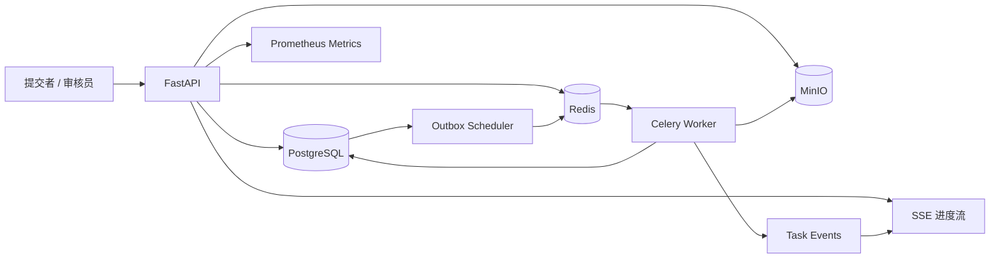
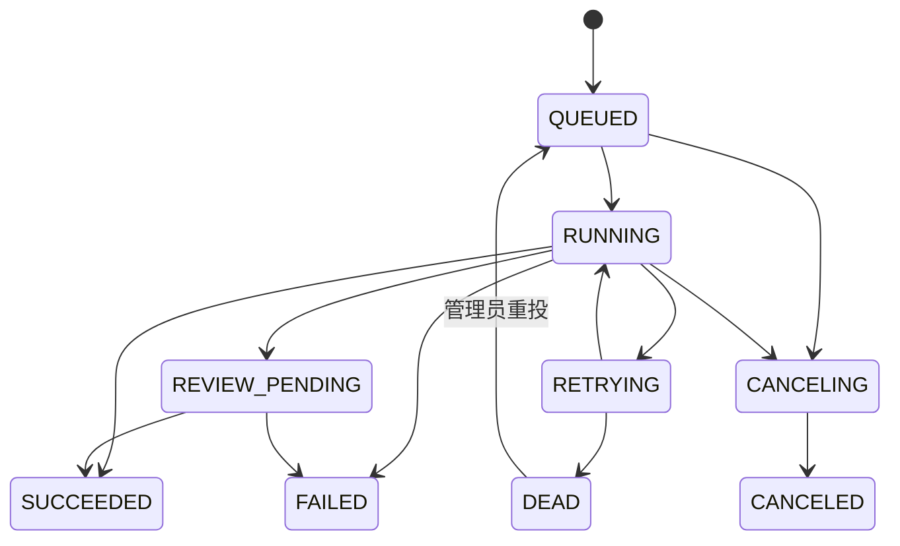
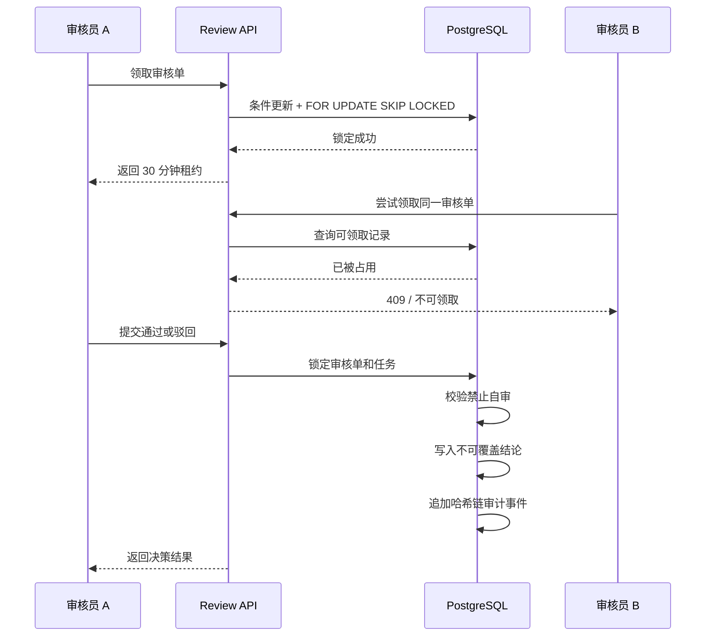
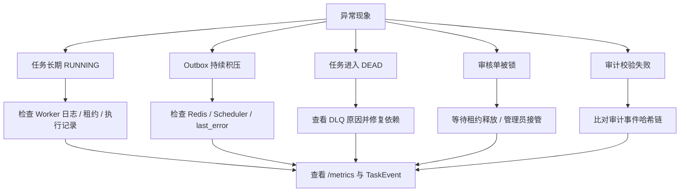

# 项目可视化与可解释性指南

本页用 Mermaid 文本描述系统结构、任务生命周期、并发审核和验证证据。所有图都可以直接在 GitHub 渲染、编辑和代码评审，不依赖外部图片。

## 图 1：项目能力思维导图

```mermaid
flowchart TD
    ROOT((工业图档审核平台))
    ROOT --> BIZ[业务能力]
    ROOT --> ARCH[系统架构]
    ROOT --> REL[可靠性]
    ROOT --> SEC[安全边界]
    ROOT --> OBS[可观测性]
    ROOT --> QA[质量保障]

    BIZ --> B1[PDF / SVG / Gerber 上传]
    BIZ --> B2[异步解析与规则分流]
    BIZ --> B3[人工审核闭环]
    BIZ --> B4[任务重试与取消]

    ARCH --> A1[FastAPI API]
    ARCH --> A2[Celery Worker]
    ARCH --> A3[PostgreSQL]
    ARCH --> A4[Redis]
    ARCH --> A5[MinIO]

    REL --> R1[事务 Outbox]
    REL --> R2[执行租约]
    REL --> R3[幂等消费]
    REL --> R4[死信队列]

    SEC --> S1[JWT + RBAC]
    SEC --> S2[Argon2]
    SEC --> S3[安全 XML]
    SEC --> S4[哈希链审计]

    OBS --> O1[Trace ID]
    OBS --> O2[SSE 进度]
    OBS --> O3[Prometheus]
    OBS --> O4[结构化日志]

    QA --> Q1[单元测试]
    QA --> Q2[Docker Compose E2E]
    QA --> Q3[Ruff + Mypy]
```

## 图 2：运行时组件与数据流

数据库保存任务、审核、审计和 Outbox 的权威状态；Redis 只承担消息、事件和队列职责；MinIO 保存原始图档与解析结果。

## 图 3：任务状态机

关键解释：`REVIEW_PENDING` 只由 warning 规则触发；critical 规则直接失败；重试耗尽进入 `DEAD`，管理员重投会创建新的执行记录，而不是覆盖旧历史。

## 图 4：并发审核时序

## 图 5：可解释性与故障诊断地图

## 视觉阅读顺序

1. 先看图 1，了解项目能力边界。
2. 再看图 2，理解 API、数据库、消息和对象存储的职责。
3. 用图 3 解释任务为什么不会只停留在 `RUNNING`。
4. 用图 4 回答审核并发和职责分离问题。
5. 用图 5 说明可观测性和故障排查路径。