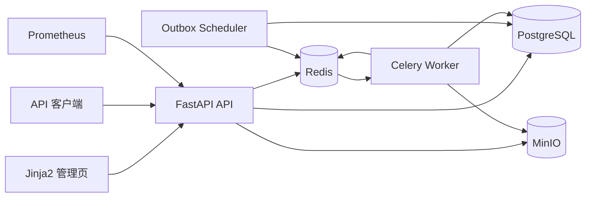
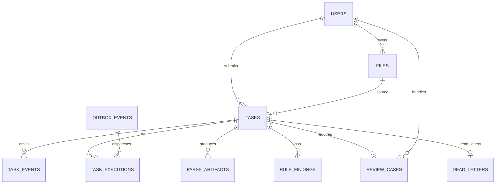

# 架构设计

## 逻辑架构

API、Worker 和 Scheduler 是无状态进程，可独立水平扩展。PostgreSQL 是任务、审核和审计状态的唯一真相源，Redis 只承担消息传输、SSE Pub/Sub 和短期指标辅助，MinIO 保存原始文件和解析结果。

## 数据模型

## 上传与幂等

1. 流式读取上传文件并计算 SHA256，超过 50 MiB 立即拒绝。
2. 校验扩展名、PDF 签名、SVG 根元素和 Gerber 文本性质。
3. 先查询 `(owner_id, idempotency_key)` 和 `(owner_id, sha256)`。
4. 原始文件写入 MinIO `raw` bucket。
5. 在同一个 PostgreSQL 事务中创建文件、任务、TaskEvent、OutboxEvent 和审计事件。
6. 并发竞争由数据库唯一约束兜底，冲突后读取已有任务并返回 `deduplicated=true`。

## Outbox 与至少一次投递

Outbox Scheduler 使用 `SELECT ... FOR UPDATE SKIP LOCKED` 领取待发布事件，发送 Celery 消息成功后标记 `PUBLISHED`。若发送成功后进程崩溃，消息可能重复投递，因此 Worker 通过 `task_executions.outbox_event_id` 唯一约束和执行租约吸收重复。

Worker 使用 `acks_late`。执行期间持续更新任务进度和租约；Scheduler 发现过期 `RUNNING` 租约后，将任务恢复到 `RETRYING` 并创建新的 Outbox 事件。

## 重试与死信

- 临时错误：最多 1 次初始执行加 3 次自动重试。
- 退避公式：`base * 2^(attempt-1)`，默认基数为 2 秒，最大 60 秒。
- 永久错误：直接进入 `FAILED`，不自动重试。
- 重试耗尽：进入 `DEAD`，创建 DeadLetter 记录并写入 `tasks.dlq` 指标/队列命名空间。
- 管理员重新入队会创建新的 Outbox 事件，不修改历史执行记录。

## 审核并发控制

审核领取使用条件更新和 PostgreSQL `FOR UPDATE SKIP LOCKED`。审核单有 30 分钟租约，持有者可以释放，管理员可以接管。决策事务锁定审核单和任务，检查职责分离后写入任务状态、审核结论和审计事件。

## SSE 与 trace

API 从 `X-Trace-ID` 读取或生成 trace ID；Outbox payload 和 Celery 参数携带任务事件标识。SSE 首先发送数据库中的完整事件快照，再订阅 Redis `task:{id}:events`。Redis 丢消息不会影响最终状态，因为任务详情始终从 PostgreSQL 读取。

## 可观测性

- `/health/live`：进程存活。
- `/health/ready`：PostgreSQL、Redis、MinIO 就绪。
- `/metrics`：HTTP 延迟、任务状态、平均进度、Outbox 积压、死信、审核积压和 Redis 队列深度。
- 结构化日志：JSON，带 trace ID、任务 ID、状态码和延迟。
